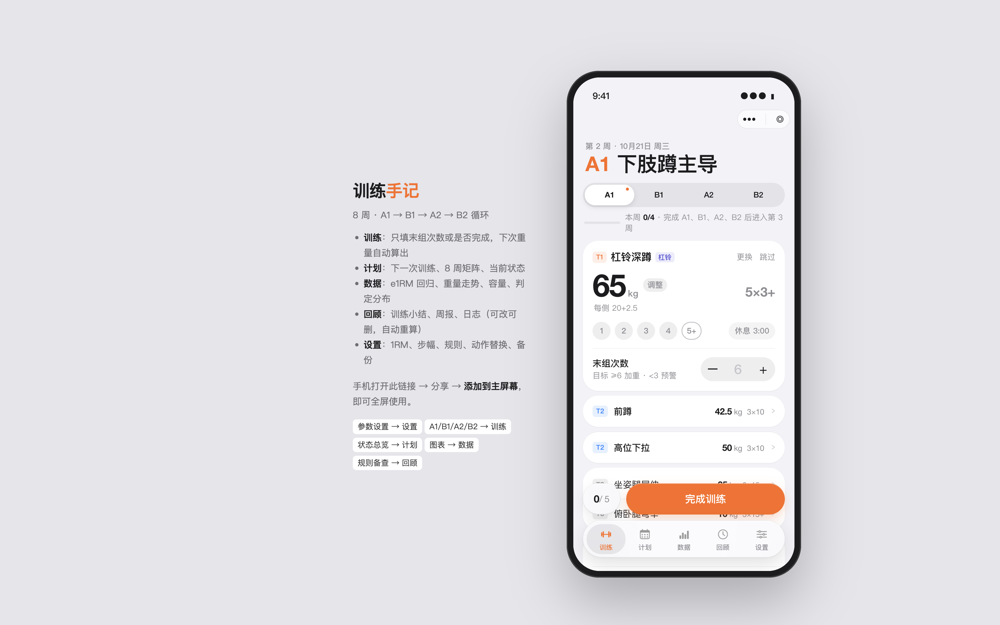

# UI/UX 审查验证报告（首次）

- 日期：2026-10-21
- 对象：本地 H5 `http://127.0.0.1:8765/`（训练页 A1）+ 源码 `source/preview/app-h5.js`、`source/preview/index.html`
- 方法：`web-design-guidelines`（Vercel，当日拉取最新规则）逐项对照 + `nielsen-heuristics-audit` 十启发式 + `impeccable` 视觉检视（实机截图）
- 说明：本报告只提审、不改代码。修复另开任务，按编号逐条改。

## 做得好的（保持）

- 数字用等宽数字：`source/preview/index.html:206`、`:950` 有 `tabular-nums`，重量/次数对齐稳定。
- 安全区已处理：tabbar、sheet、导航多处 `env(safe-area-inset-*)`（`index.html:31,187,274`）。
- 焦点可见：`index.html:949` 有 `:focus-visible` 描边；减动效有 `prefers-reduced-motion`（`:696,967`，但不完整，见下）。
- 计划切换有只读说明与「回到当前计划」出口（`app-h5.js:254-256`），符合用户控制与防错。

## 问题清单（按严重度）

### S3 · 主要问题

1. **底部「完成训练」遮挡内容与计数**
   - 证据：截图中 submit-bar 压住 T3 动作行，左侧 `0/5` 计数被按钮盖住一半；`app-h5.js:394` 生成、两套样式在 `index.html:70` 与 `:663`。
   - 违反：Nielsen H1 系统状态可见（进度看不清）；Web 指南「粘性底栏不得遮挡内容」。
   - 改法：内容区加等于底栏高度的 `padding-bottom`；计数与按钮改为上下两行或计数移入按钮文案（如「完成训练 · 0/5」）。

2. **大量可点区域是 `
`，键盘与读屏不可达**
   - 证据：`app-h5.js` 中 `tap` 行约 27 处，如动作选择 `:21`、分段 `:220`、组数圆点 `:363`；只有 PR 行一处补了 `role="button"`+`aria-label`（`:1006`）。
   - 违反：Web 指南「用 `<button>`/`<a>`、交互元素需键盘处理」；Nielsen H7 灵活性。
   - 改法：优先把圆点、seg、chip 换成语义按钮或补 `tabindex="0"`+键盘事件；图标按钮补 `aria-label`。工作量大，建议先覆盖训练页主路径（圆点、提交、关闭）。

### S2 · 次要问题

3. **`transition: all` 与全局去掉 outline**
   - `index.html:38` toast 用 `transition: all .2s`；`index.html:135` 全局 `outline: none`（虽 `:949` 对 `.app` 内补了 focus-visible，但 `.phone` 外壳层仍无替代）。
   - 改法：toast 改为 `transition: opacity .2s, transform .2s`；全局 outline 只在有替代焦点样式的容器内移除。

4. **Toast 无 `aria-live`，异步反馈读屏听不到**
   - 证据：`index.html:38` 的 `#toast` 无 `aria-live="polite"`。
   - 改法：加 `aria-live="polite"`。

5. **表单标签靠占位符**
   - 证据：体重、备注、末组次数等输入只有 `placeholder`（`app-h5.js:371,392-393`），部分有视觉 label、部分没有 `aria-label`/关联 label。
   - 改法：保留视觉 label 结构并给 input 补 `aria-label`（如「末组次数」）；`placeholder` 末尾按规范用 `…` 示意示例。

### S1 ·  cosmetic

6. **文案标点与减动效覆盖不全**：`prefers-reduced-motion` 只关了平滑滚动（`index.html:967`），过渡动画仍在跑；报告类文案后续统一「…」与直引号检查即可。

## 启发式小结（Nielsen 0-4，取每条最高问题）

| 启发式 | 最高严重度 | 代表问题 |
|---|---|---|
| H1 状态可见 | 3 | 底栏遮挡完成进度（问题1） |
| H3 用户控制 | 0 | 只读计划有明确出口，做得好 |
| H4 一致性 | 1 | 两套 submit-bar 样式并存，后续易走样 |
| H5 防错 | 1 | 删除/结束计划已有确认与只读拦截，未见新问题 |
| H6 识别而非回忆 | 2 | 图标/圆点无文本与 aria 说明（问题2） |
| H7 灵活高效 | 2 | 键盘不可达（问题2） |
| H9 错误恢复 | 2 | Toast 无 aria-live、错误提示规范待补（问题4/5） |

## 下一步建议（按性价比）

1. 先修问题 1（底栏遮挡）：影响每次训练，改动小。
2. 再修问题 4 + 3：两处 CSS/属性，十分钟级。
3. 问题 2 单独立项：先覆盖训练页，再扩到计划/数据页。
